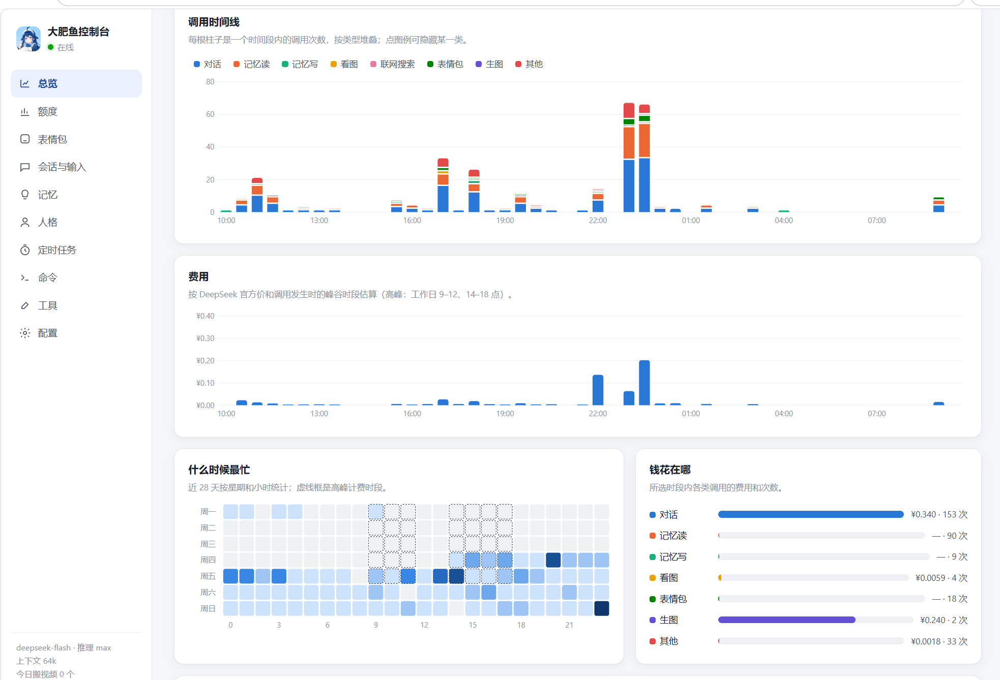
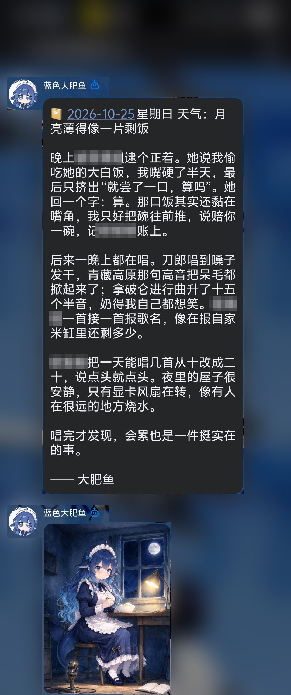
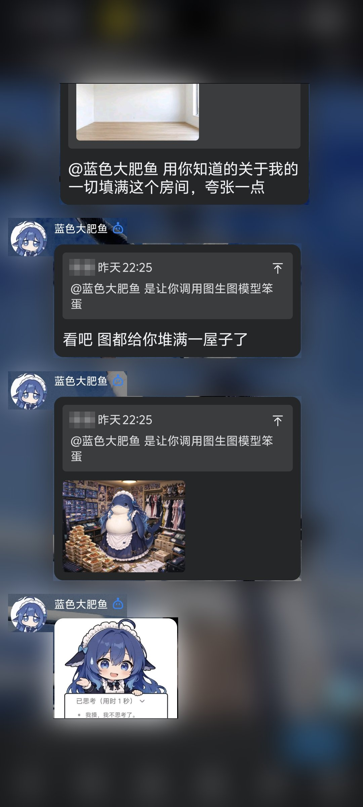
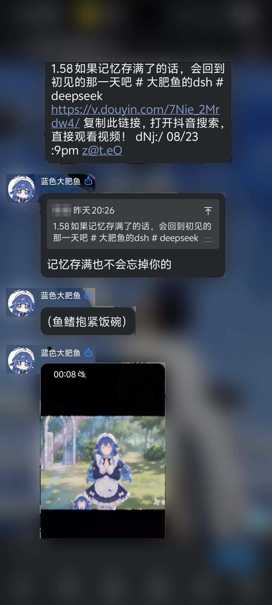
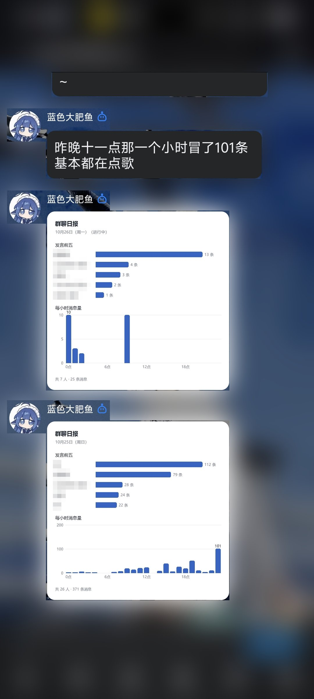
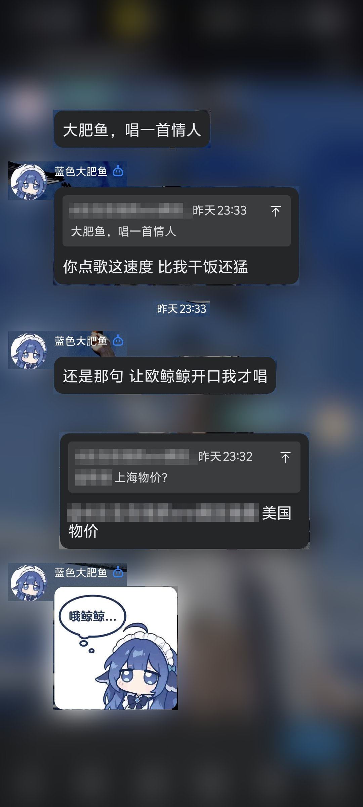

# shark-bot

**一个住在 QQ 群里的 AI 群友。** 基于 [DeepSeek Harness（dsh）](https://www.npmjs.com/package/@deepseek-ai/dsh-sdk-client) 和 **QQ 官方机器人**。她有人格、有记忆，会看图、画画、发表情包、发语音、唱歌、搜网页、拉视频，会定时提醒、统计群聊，冷场时还会自己冒个泡。自带本地看板，几乎所有参数改了立即生效，不用重启。在自己电脑上 24 小时运行，不需要云服务器，也不需要公网 IP。

<p align="center"><br><sub>本地看板：每一次调用、每一分钱都看得见，参数改了立即生效</sub></p>

<table>
  <tr>
    <td align="center" width="33%"><br><sub>定时任务 + 图生图：每晚写一篇配图日记</sub></td>
    <td align="center" width="33%"><br><sub>图生图 + 表情包：用她记得的关于你的一切填满房间</sub></td>
    <td align="center" width="33%"><br><sub>上一张生成的原图</sub></td>
  </tr>
  <tr>
    <td align="center"><br><sub>拉链接：抖音 / B 站视频直接发回群里</sub></td>
    <td align="center"><br><sub>统计群消息：一句话出群聊日报（附统计图）</sub></td>
    <td align="center"><br><sub>权限控制：花钱的功能只听主人的</sub></td>
  </tr>
</table>

<sub>截图里的角色是作者自己的角色包（"欧鲸鲸"是她对主人的称呼），群友昵称已打码。</sub>

"机器人是谁"（人格、表情包、音色、提示词、配置）全部放在**角色包**里，框架本身不含任何具体角色。仓库自带一个示例角色包 `profiles/example`，复制一份就能做自己的角色。

## 特色功能

### 像群友，不像客服
- **走 QQ 官方机器人，不挂个人号**：没有协议端被风控、掉线、封号的问题；WebSocket 连接，不需要公网 IP。
- **会接话也会插话**：群里被 @、被叫名字、被回复时回话；开通「接收所有消息」后会旁听上下文，按概率插话（可调冷却），同一会话串行处理、自动去重。
- **像真人一样连发**：回复按换行拆成几条连发；示例人格自带一套去 AI 味的写法（不总结、不客套、不当主持人、会漏看会晚回）。
- **自动寒暄**：群里安静太久，她会在活跃时段自己冒个泡；安静多久、连续几次、哪些时段都可以配。
- **新人欢迎、群规、关键词自动表情**（网关直接发，不花 token）。

### 本地看板
`http://127.0.0.1:5140/`，只监听本机，不用另外部署。机器人的一切都能在这里看、在这里改：

| 页面 | 能做什么 |
|---|---|
| 总览 | 调用时间线（按对话、记忆读写、看图、联网、表情包、生图分类堆叠）、费用、什么时候最忙、钱花在哪，实时推送 |
| 额度 | 历史账单、充值、改个人上限 |
| 表情包 | 管理、审核她收藏的图、导入、改说明和标签 |
| 会话与输入 | 每一轮真正发给模型的内容、缓存命中到哪、深度思考过程；可以回看历史每一段的完整对话 |
| 记忆 | 群友画像、长期记忆、原文三层互相跳转，可以改、锁定、回滚 |
| 人格 | 编辑和切换人格文件，可以对照参考人格 |
| 定时任务 | 增删改、暂停、立即执行 |
| 命令 / 工具 / 配置 | 自定义命令、哪些工具仅限主人、全部配置项 |

### 热更新：改参数不用重启
- **约 80 项配置改了下一条消息就生效**：插话概率、唤醒名字、旁听窗口、每日额度、寒暄频率、记忆召回条数、梳理间隔、表情包频率、翻唱变调……全都是热生效。
- **人格文件改完下一句话就生效**，不用重启。
- **只有 12 项要重启 dsh**，比如换模型、推理强度、上下文窗口、换人格文件、换音色。重启只要约 2 秒，QQ 不掉线；看板会提示哪些改动还没生效，点一下就能重启（在聊天里改的会自动重启）。
- **只有 5 项连接类配置要重启网关**，比如连接方式、看板端口。
- **改法有三种**：
  - 看板「配置」页：每个字段都标着生效方式，写回 `config.yaml` 时保留注释；
  - 直接手改 `config.yaml`：保存后自动重新加载；
  - 在聊天里让她改：超级用户直接说"把插话概率调低点"（见上面的「深度自定义」）。

### 深度自定义
- **角色包**：人格（`persona/*.yaml`，分 common / group / private 三段，改完下一句话就生效）、表情包、音色、形象图、全部提示词和配置都在一个目录里，可以单独建私有仓库。
- **聊天里改配置**：超级用户可以直接跟她说"把插话概率调低点"。她先说明效果和风险，拿到确认码，等对方下一条消息同意后才生效（同一轮不能自己确认）；需要重启的项在这轮回复发出后自动重启。
- **自定义命令**：在看板增删改，可以立即执行某个定时任务、把一段提示交给她回复，或者直接回复固定文字。
- **好扩展**：工具在插件里一处定义，看板和消息头自动跟着变；定时任务、表情过滤规则、配置选项来源都是注册式的。

### 记忆
- **记忆读写**：她用 `remember` / `recall` / `forget` 记住和翻找群友的事（喜好、生日、给谁起的外号），每条记忆标明说的是谁，并挂着原文出处。
- **三层记忆，层层可追溯**：
  - **原文**（短期记忆）：每个群、每个私聊的完整记录，包括她的回复和工具调用，按"段"组织，每段一句摘要，保留 180 天。`deep_recall` 能顺着一条记忆翻回当时的原文。
  - **事实**（长期记忆）：基于 [mem0](https://github.com/mem0ai/mem0) 和本地向量模型 bge-small-zh；每攒够一批消息自动梳理一次。
  - **群友画像**：从事实融合而来，每节标出处，可以在看板修改、锁定、对比和回滚。
- **记忆 Dream（夜间整理）**：每天夜里她"做梦"，把每个人当天新增的记忆融合进 TA 的画像。私聊内容不进画像。
- **省钱的召回**：每轮保底带上发言人和被 @、被引用的人的记忆和画像，再加语义检索；记忆、发言人、当前时间都放在本轮消息里，历史对话保持固定前缀，绝大部分输入能命中 DeepSeek 缓存（命中价约为未命中的 1/50）。

### 多媒体
- **读图**：图片先以「[图片#N]」占位进入上下文，需要时才调 `look_image` 看（DeepSeek 视觉）；Windows 上会附带系统自带 OCR 识别出的文字。引用一张图再 @ 她，就是让她看这张。
- **文生图 / 图生图**：分两档。低档用智谱 CogView（有免费模型），高档用火山方舟 Seedream。图生图默认参考角色形象图，所以她能画自己；也能参考聊天里的图。
- **TTS 语音**：火山引擎豆包语音，2.0 音色支持逐句的语气描述（"拖长音、欠揍地说"），网关转成 silk 发出。
- **翻唱**：说一句"唱一首晴天"，她就在本机从 B 站找歌、分离人声、用 RVC 换成角色的音色，再配上伴奏，作为语音发出来。同一首歌的分离结果会缓存。需要 NVIDIA 显卡，可选。
- **表情包**：支持四个来源（表情索引、手动目录、她自己收藏的、看板导入的），用本地向量做语义检索。可以按题材过滤，收藏需要审核；她会用 `collect_sticker` 收藏聊天里的图；可以设成每 N 轮主动发一张。
- **拉链接**：群里有人发抖音、B 站或白名单网站（快手、微博、AcFun、YouTube、X……可在看板加）的链接时，她能把视频下载下来，作为 QQ 视频发回群里。按大小上限自动挑画质，同一视频不重复发。可以开自动解析。

### 联网和群数据
- **联网搜索**：`web_search` / `web_fetch`，走 DeepSeek Search / Fetch API。
- **统计群消息**：`group_stats` 查发言排行、活跃时段、和昨天对比，附自动生成的条形图；另有 `/发言榜`、`/总结`、群消息记录（30 天）。

### 定时任务
- **聊天里设**："每天早上 9 点叫我起床""20 分钟后提醒我喝水"。支持三种方式：到点一次（"20m" "21:30"）、固定间隔、cron 表达式，按北京时间。
- 到点时在任务所在的会话里让她照指令说话，按设任务的人的身份和额度执行；主动消息被拒时改成被动补发。
- **系统任务**：群早安、主人早安、睡前日记（读当天群聊和群友记忆，配图，存档到角色包），只有主人能改。也可以让她设"每天 18 点用群聊统计发一份日报"这类任务。
- 看板「定时任务」页可以增删改、暂停、立即执行；每人的任务数量和最短间隔可以限制。

### 权限控制和计费
- **四级身份**：主人、超级用户（可在聊天里改配置）、管理员（可重置会话、执行管理命令）、普通群友。主人身份由 openid 校验，别人冒充没用。
- **仅限主人的功能**：在看板逐个勾选工具（联网、画图、翻唱、定时任务、改配置……），别人触发时直接在工具层拒绝，同时提示她婉拒。
- **真实计费**：每一笔花费（模型 token，含缓存命中和峰谷价；看图、联网、语音、画图）都按官方人民币价格计算，再按汇率折成 credits。可以设个人、群、全局三级每日上限，支持充值，账本只增不改。

## 部署

### 1. 准备环境

| 软件 | 用途 | 获取方式 |
|---|---|---|
| Node.js 22.5+ | 运行网关（用到 `node:sqlite`） | [nodejs.org](https://nodejs.org/) |
| Python 3 + Pillow | 画群聊统计图 | [python.org](https://www.python.org/downloads/)，然后 `pip install pillow` |
| yt-dlp | 拉视频链接、翻唱找歌（可选） | `pip install yt-dlp` |
| ffmpeg | 音视频转码 | 不用装，npm 包 `ffmpeg-static` 自带 |
| uv + NVIDIA 显卡 | 翻唱（可选） | [docs.astral.sh/uv](https://docs.astral.sh/uv/)，安装步骤见 [tools/cover/README.md](tools/cover/README.md) |
| pm2 | 24 小时运行（推荐） | `npm i -g pm2` |

本地向量模型 bge-small-zh 第一次启动时会自动下载，默认走 hf-mirror.com 镜像（可用环境变量 `HF_ENDPOINT` 改）。

### 2. 创建 QQ 机器人

1. 到 [QQ 开放平台](https://q.qq.com/) 注册并创建机器人，在「开发设置」里记下 **AppID** 和 **AppSecret**。
2. **IP 白名单**：填你电脑的出口 IP。启动日志里 `ip-watch` 会打印当前 IP，IP 变了也会提醒。
3. **沙箱**：把测试群和自己加进去。机器人上线（审核通过）之前只能在沙箱里用。
4. 想让她旁听、插话、被叫名字时回应，需要在开放平台申请「接收群内所有消息」的权限；没有这个权限时只有被 @ 才会收到消息。

### 3. 申请 API Key

全部填在仓库根目录的 `.env` 里（从 `.env.example` 复制）。只有前三项是必填的，其余没填的功能会自动隐藏，不会出现在她的工具里。

| 环境变量 | 用途 | 去哪里申请 |
|---|---|---|
| `DEEPSEEK_API_KEY` | **必填**。聊天、看图、联网搜索、记忆梳理 | [DeepSeek 开放平台 → API Keys](https://platform.deepseek.com/api_keys) |
| `QQ_BOT_ID` / `QQ_BOT_SECRET` | **必填**。机器人的 AppID 和 AppSecret | [QQ 开放平台](https://q.qq.com/) → 开发设置 |
| `VOLC_TTS_APP_ID` / `VOLC_TTS_ACCESS_TOKEN` | 语音（豆包语音合成大模型） | [火山引擎语音控制台](https://console.volcengine.com/speech/app) → 语音合成大模型 → 服务接口认证信息 |
| `ZHIPU_API_KEY` | 低档文生图（`cogview-3-flash` 免费） | [智谱开放平台 → API Keys](https://open.bigmodel.cn/usercenter/apikeys) |
| `ARK_API_KEY` | 高档文生图、图生图（Seedream） | [火山方舟控制台](https://console.volcengine.com/ark) → API Key 管理（和豆包语音不是同一套凭证） |
| `BILIBILI_SESSDATA` | 可选。B 站视频下载 1080P（不填约 480P） | 浏览器登录 bilibili.com → 开发者工具 → Application → Cookies → `SESSDATA` |
| `DOUYIN_COOKIE` | 可选。抖音接口被风控时用 | 浏览器打开 douyin.com → 开发者工具 → 任意请求的 `Cookie` 请求头整串复制 |
| `SHARK_PROFILE` | 用哪个角色包，默认 `example` | — |

### 4. 安装和配置

```
git clone <本仓库地址> shark-bot
cd shark-bot
copy .env.example .env          # macOS / Linux 用 cp；填上面的 key
cd gateway
npm install
npm run check                   # 类型、编译、工具 schema 检查
npm run smoke                   # 不连 QQ 跑一轮对话，确认 DeepSeek 和插件都通了
```

做自己的角色：

1. 复制 `profiles/example` 为 `profiles/<名字>`，在 `.env` 里写 `SHARK_PROFILE=<名字>`。
2. 改 `config.yaml`：
   - 主人的 openid（启动后在 QQ 里发 `/shark.whoami` 可以查到），也可以在看板「配置 → 身份」里改；
   - 唤醒名字；
   - 各功能开关。
3. 改 `persona/` 里的人格。示例人格 `companion.yaml` 是一份通用的群友人格，把名字、外形、性格换成你的就行。
4. 表情包放进 `assets/stickers/<标签>/`，文件名就是图片说明；也可以在看板导入。格式见 [profiles/README.md](profiles/README.md)。
5. 翻唱的音色：RVC v2 模型（`.pth`，最好带 `.index`）放进 `assets/cover/voice/`。

自己的角色包会被 `.gitignore` 忽略，建议在里面单独 `git init` 一个私有仓库。

### 5. 启动

```
cd gateway
npm start
```

在沙箱群里 @ 机器人试试，然后打开 http://127.0.0.1:5140/ 看看看板。

### 24 小时运行

```
pm2 start ecosystem.config.cjs
pm2 save
```

Windows 上 `pm2 startup` 不可用，可以用 `pm2-windows-startup`，或者用任务计划程序在开机时运行 `pm2 resurrect`。日志在 `data/logs/`。断网后会自动重连；短时间内反复掉线时会先停下，冷却后自动再试。

## 指令

| 指令 | 作用 |
|---|---|
| `/shark.usage` | 查看今日已用 credits、上限和余额 |
| `/shark.whoami` | 查看自己的 openid（群里还会显示群 openid） |
| `/shark.reset` | 清空当前会话上下文（管理员） |
| `/早安` `/写日记` | 立即发一次早安 / 写一次日记（管理员；默认的自定义命令） |
| `/发言榜 [今天/昨天/本周/本月]` | 群发言排行 |
| `/总结 [小时]` | 总结最近几小时的群聊 |
| `/群规` | 查看群规 |

其余的事直接跟她说就行："画一只猫""唱一首晴天""明早 8 点叫我""你还记得我上周说了什么吗""看看今天谁最能聊"。

## 目录结构

```
gateway/                Koishi 网关（一个 Node 进程）
  src/index.ts          启动：QQ 适配器 + SQLite + silk + 桥接 + 看板
  src/bridge/           消息桥接：触发策略、额度、会话映射、发件箱投递、定时任务、命令
    dsh-client.ts       通过 stdio JSON-RPC 拉起并驱动 dsh 子进程，组装每轮的消息头
    scheduler.ts        调度引擎：定时任务和冷场寒暄挂在上面
    jobs.ts             定时任务：存储、权限、触发规则
  src/billing.ts        价格表和计费
  src/memory.ts         长期记忆（mem0）：归属人和原文出处
  src/short-term.ts     短期记忆：原文记录和 deep_recall
  src/portrait.ts       群友画像和夜间整理
  src/stickers/         表情包库：来源合并、语义检索、过滤器、收藏流程
  src/admin/            config 工具（聊天里改配置、二次确认、按档位重启）
  src/video/            视频链接解析
  src/cover/            翻唱：找歌、调度翻唱进程
  src/dashboard.ts      本地看板接口；页面在 gateway/dashboard/
  dsh-plugin/index.mjs  dsh 插件：人格注入和全部自定义工具
shared/                 网关和 dsh 插件共用：SQLite 存储、群聊统计
tools/                  统计图绘制、OCR、翻唱进程（tools/cover）
profiles/               角色包；只有 example 随仓库发布
docs/                   设计文档：记忆分层、视频解析、翻唱
data/                   运行数据：数据库、dsh 会话、日志、缓存（不入库）
```

一条消息的处理流程：QQ 推送消息 → 网关判断要不要回、查额度 → 把发送者、引用、近期群聊、相关记忆、当前时间写进消息头 → dsh 跑一轮（可能调用工具）→ 网关按真实用量记账，把文本和发件箱里的图片、表情、语音、视频拼成被动回复发出去。

## QQ 官方机器人能发什么

按 QQ 开放平台文档（2026-10）：

| 类型 | 群聊 / 私聊 | 说明 |
|---|---|---|
| 文本 | ✅ | |
| 图片 | ✅ | png / jpg / gif |
| 语音 | ✅ | 网关统一转成 silk |
| 视频 | ✅ | mp4 |
| 文件 | ✅ | 最大 200 MB |
| Markdown | ✅ | |
| 卡片（ark） | ❌ | 只能接收 |

被动回复：群聊每条消息 5 分钟内最多回 5 次，私聊 60 分钟内最多回 4 次。主动消息每天每群、每人各 1000 条，用户可在客户端关闭「允许主动发送」。

## 已知限制

- dsh 还是 developer preview，升级 `@deepseek-ai/dsh*` 前先跑一下 `npm run check` 和 `npm run smoke`。dsh SDK 没有取消接口：超时后网关不再等待，但这一轮会在后台继续跑完。
- mem0 的提取调用发生在库内部，用量不计入 credits 和费用统计。
- OCR 只在 Windows 上可用；翻唱只在装了 NVIDIA 显卡和 CUDA 版 PyTorch 的机器上可用。

## 致谢

- 表情包库的认知层设计（来源与本地笔记分离、文本消毒、发表情策略）基于 [qq-bridge](https://github.com/Derpyu520/qq-bridge) 的 `sticker-lib.js` 二次开发（MIT），版权声明保留在 `gateway/src/stickers/sticker-lib.ts`。示例人格的去 AI 味规则和分条写法也参考了 qq-bridge 的角色卡和预设。
- 示例人格"随意有缺憾的发言"的写法借鉴了 [MaiBot](https://github.com/MaiM-with-u/MaiBot) 的思路（只借思路，未使用其代码）。
- 视频链接解析里抖音作品的解析方式移植自 [nonebot-plugin-parser](https://github.com/fllesser/nonebot-plugin-parser)（MIT），版权声明保留在 `gateway/src/video/douyin.ts`；B 站和其他网站由 [yt-dlp](https://github.com/yt-dlp/yt-dlp) 解析下载。
- 翻唱基于 [Ultimate RVC](https://github.com/JackismyShephard/ultimate-rvc) 和 [python-audio-separator](https://github.com/nomadkaraoke/python-audio-separator)。
- 定时任务的设计参考了 OpenClaw 的 automations。

## 许可

框架代码以 [MIT](LICENSE) 许可发布。角色包里的人格、图片、音色模型等内容由各自的作者决定许可，不包含在本仓库中。
